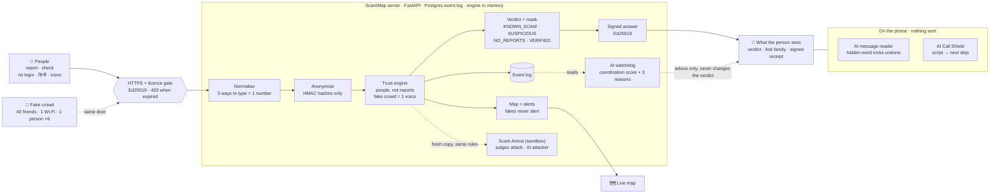

# Community Scam Map for India

**Report and check a scam in seconds, anonymously.** We count *people*, not reports: a crowd of fake friends counts as one voice. Four AI parts watch and explain; **none of them can change a verdict**. No LLM anywhere, and nothing personal is stored.

| Open | What to do there |
|---|---|
| <https://scammap-yp1k.onrender.com> | **Report** in under a minute: paste a whole SMS and the number is picked out; icons, English or हिन्दी, no login. |
| <https://scammap-yp1k.onrender.com/#check> | **Check** a number, UPI ID, link or sender: verdict, AI watchdog line, "Ask family before you pay", **signed receipt**. |
| <https://scammap-yp1k.onrender.com/judge> | **Judge console**: one button runs every scoring check on a sandbox copy (32 of 32 in our runs); licence panel; signature check. |
| <https://scammap-yp1k.onrender.com/live> | **Live scam map**: 7-day areas, top scams, alerts. Fake campaigns never move it. |
| <https://scammap-yp1k.onrender.com/shield> | **AI Call Shield** (press "Play a demo call") and **Attack our AI** (tap a trick, watch a plain model fail next to ours). |
| <https://scammap-yp1k.onrender.com/arena> | **Scam Arena**: play the attacker against our rules, or let our AI attacker try 150 plans. Sandbox only. |
| [https://scammap-yp1k.onrender.com/receipt](https://scammap-yp1k.onrender.com/receipt#r=eyJhIjp7InYiOjEsImtleV9pZCI6IjE2ZWI1ODNlIiwiaXNzdWVkX2F0IjoiMjAyNi0xMS0wMVQxMDozMDoxMCswNTozMCIsInR5cGUiOiJwaG9uZSIsInZhbHVlX3NoYTI1NiI6IjZjNjkzMDM5OWE4M2RiNzVlZmYyNjcyYzViOTIwNWYzMWRhMDhkOGI0YTE1YjY3M2EzNmYxMzNjNTc5NWRkNWIiLCJ2ZXJkaWN0IjoiS05PV05fU0NBTSIsInZvaWNlcyI6NSwicmVwb3J0X2NvdW50Ijo1LCJjb25maWciOiJkN2EyM2I0YyIsInNpZyI6Ik4zSTlYVHMydUZsd3NCajd0VVlGR3ZuR2IyRjlyTXIxb0MyZHQwRUxWUFVmbFJwSDVGb1owa0twby9VdE5YTXdxWWcxR2ZLQWl4ZFBrc1dtSjkydUJ3PT0ifSwidiI6Iis5MTkwMDAwMjY0MzMifQ) | **Signed Scam Receipt**: a sample the live server signed on 1 Nov (Known scam, 5 people). It shows GENUINE; press "Try to fake it" and it turns TAMPERED. Make your own from any Check result. |

## Architecture in one picture



## For judges: where to check each scoring row

| Row | What we built | Check it |
|---|---|---|
| 1. Fake reports | Trust rules count independent people: same reporter, same Wi-Fi within 24 h, pasted text, or a burst of new accounts = **one voice**. Verified businesses can't be marked. | `/judge` row 1 (12 checks); [How the trust rules work](#how-the-trust-rules-work); [attack table](#attack-table-in-our-tests-config-d7a23b4c-engine-v13) |
| 2. Lookup | `+91 90000 12345`, `09000012345` and `9000012345` are one number; answers from memory. | `/judge` row 2; `GET /lookup` |
| 3. Map and alerts | SPIKE (5+ and 2× usual), NEW_TYPE, 7-day window; only clean voices count. | `/live`; `/judge` row 3 |
| 4. Privacy | Reporter and network kept only as keyed hashes; numbers masked until 3 people agree; area centre points, never GPS; careful wording ("reported by 7 people", never a label on a person). | `/judge` row 4; [Privacy](#privacy) |
| 5. Licence | Ed25519-signed licence; expired = `403 LICENSE_EXPIRED` on every route but `/health` and `/license`; renewed with **no restart**; data kept. | `/judge` licence panel; [How the licence works](#how-the-licence-works) |
| 6. Easy to report | Paste anything, icons for every choice, Hindi, no login, a few taps. | `/` on a phone |
| 7. Demo and code | This README, 440 + 60 browser tests, CI on every push, honest [known limits](#known-limits). | [Proof](#proof) |
| Bonus | Verified businesses, disputes, fake reports never raise alerts. | `/judge` bonus (3 checks) |

**What is different here:** the AI can explain but never decide · we attacked our own AI and hardened it ([Attack our AI](#attack-our-ai-tricks-that-hide-words-undone-and-turned-into-red-flags)) · every answer is signed and can be carried as a [receipt](#signed-scam-receipt) · limits are written down, not hidden.

Security notes: [SECURITY.md](SECURITY.md). Libraries, services and AI tools: [DISCLOSURE.md](DISCLOSURE.md). Numbers in this README come from our own tests with synthetic data, not from the judges' tool and not real-world accuracy.

---

## AI Call Shield: it knows the caller's script

`/shield`, and "AI Shield" in the menu on every page. Scam calls follow scripts, and the caller changes numbers but not the script. While someone is on a call, they type or paste what the caller says, line by line. The AI on the phone answers four things:

- which script it is: digital arrest, bank KYC and OTP, task job, or UPI refund and QR;
- which of its 5 steps the caller is on;
- **what they will ask for next, before they ask**;
- what to do right now: hang up, call 1930, ask family, or report the number.

"Play a demo call" plays a made-up "CBI officer" digital-arrest call. The AI names each step as it comes and marks the steps it predicted one line early: on the demo call, 4 of 4.

**How it works.**
- **Reading each line.** A multinomial Naive Bayes model scores each line against the 20 script steps and "chatter" (ordinary call talk, which it skips). It uses the same tokenizer and features as the message reader.
- **Following the call.** A hidden Markov model follows the call: each script runs forward through its steps (stay, next, skip ahead; rarely back). After every line, the forward algorithm turns the line scores into "which script, which step", so one unclear line does not throw it off. The transition table gives the most likely next step.
- **On the phone.** Everything runs in the browser (`app/static/ai/shield.js`). The model file (`app/static/ai/shield_model.json`, 115 KB) is downloaded once. What the person types is never sent, and a browser test records every request to check this. The "Ask family" message names the script and the step, never the caller's words.
- **Advisory only.** No LLM and no outside service. It never touches a verdict and is labelled "AI suggestion, can be wrong".
- **Reproduce it.**
  - `python tools/ai/shield_data.py` writes the 740 synthetic training lines in English, Hinglish and Hindi.
  - `python tools/ai/train_shield.py` cross-validates, checks the held-out calls and writes the model.
  - A browser test checks that the browser and Python give the same answer on every held-out call.

Results **on our synthetic data** (real calls: not measured):

| Measure | Result |
|---|---|
| Lines put on the right step (5-fold cross-validation, 740 lines) | 92.8% |
| Lines put on the right script | 93.5% |
| 9 calls written separately, never trained on: right script, step and next step | 9 of 9, after one fix (below) |
| 3 short calls with skipped steps, written before that fix was run | 3 of 3 |

The fix: the first version could not skip two steps ahead, so a Hinglish call that went from accusation straight to payment stayed on "accusation" (8 of 9). Real callers skip steps, and people type only the key lines, so we added a small chance of a longer jump ahead. Because one of the 9 calls showed us the problem, the 9 are no longer a blind test of that change; the 3 newer calls are.

Limits:
- Four scripts only. A call that follows another script gets the nearest one, or no reading.
- The training lines are synthetic, written for this project. A caller who avoids the usual words gets a weak or wrong reading.
- It needs the words typed in; it does not listen to the call.

---

## Run locally

**Requirements:** Python 3.12+ (or Docker). Install into a virtual environment: a plain `pip install` is refused by the system Python on recent Ubuntu, Debian and Homebrew (`externally-managed-environment`).

macOS / Linux (on Debian or Ubuntu, `sudo apt install python3-venv` first if `venv` is missing):

```bash
python3 -m venv .venv
. .venv/bin/activate
pip install -r requirements.txt
export TRUST_SALT=my-local-salt   # any stable string; changing it splits reporter histories
python -m uvicorn app.main:app --host 127.0.0.1 --port 8000 --no-access-log
```

Windows (PowerShell):

```powershell
python -m venv .venv
.venv\Scripts\python -m pip install -r requirements.txt
$env:TRUST_SALT = "my-local-salt"
.venv\Scripts\python -m uvicorn app.main:app --host 127.0.0.1 --port 8000 --no-access-log
```

The server uses SQLite by default. On a fresh database it installs the licence in `licenses/long.json` by itself, so it answers at once. Check it from a second terminal:

```bash
curl http://127.0.0.1:8000/health                                     # {"ok":true}
curl "http://127.0.0.1:8000/lookup?type=phone&value=%2B919000012345"  # 200, verdict NO_REPORTS
```

```powershell
Invoke-RestMethod http://127.0.0.1:8000/health
Invoke-RestMethod "http://127.0.0.1:8000/lookup?type=phone&value=%2B919000012345"
```

Or with Docker (app + Postgres):

```bash
docker compose up --build
# Server at http://localhost:8000 (docker-compose.yml maps port 8000 to the app)
```

---

## API

JSON in and out. Times are ISO 8601 with `+05:30`. Errors: `{"error": "<code>"}`. No login on any route.

| Route | Method | Success | Errors |
|---|---|---|---|
| `/health` | GET | `200 {"ok": true}` | — |
| `/reports` | POST | `201 {"report_id", "case_id", "merged"}` | `400 {"error": "…"}` |
| `/lookup?type=&value=` | GET | `200` (verdict object, plus a signed `attestation`: see [Signed answers](#signed-answers)) | `400` for impossible values |
| `/attestation/key` | GET | `200 {"alg": "Ed25519", "key_id", "public_key"}` | — |
| `/map?pincode=&days=7&radius_km=2` | GET | `200 {"clusters": [...]}` | `400` for malformed pincode |
| `/alerts?pincode=` | GET | `200 {"alerts": [...]}` | `400` for malformed pincode |
| `/admin/reset` | POST | `200 {"ok": true}` | — |
| `/challenges` | POST | `201 {"challenge_id", "status": "under_review"}` | `400` |
| `/license` | GET | `200` (licence status) | — |
| `/license` | POST | `200` (installed licence) | `400 {"error": "INVALID_LICENSE"}` |
| `/live/summary?days=7` | GET | `200` (areas, top scam types, most reported numbers and alerts for the live map) | — |
| `/demo/run` | POST | `200` (the judge console's sandbox checks) | `429 {"error": "busy"}` |
| `/arena/attack` | POST | `200` (one sandbox attack: see [Scam Arena](#scam-arena-play-the-attacker)) | `400 {"error": "invalid_params"}`, `429` |
| `/arena/redteam` | POST | `200` (our automated attacker, sandbox only) | `400 {"error": "invalid_params"}`, `429` |

The last four routes are our own additions. The organisers' routes above them are unchanged.

When the licence is not valid, every route except `/health`, `/license`, the pages (`/`, `/live`, `/judge`, `/arena`, `/shield`) and static files returns `403 {"error": "LICENSE_EXPIRED"}`.

Unknown routes return `404 {"error": "not_found"}`. Wrong method returns `405 {"error": "method_not_allowed"}`. Error messages never echo user input.

---

## How the trust rules work

The system counts independent **voices**, not raw reports. A number is marked KNOWN_SCAM only when at least 3 voices report it and they add up to at least 1.5 points. Fewer voices means SUSPICIOUS. No reports means NO_REPORTS. No single signal decides: who reported, from which network, when, from which area, with what track record.

1. **Junk is turned away at the door.** A number, UPI ID, link or sender that cannot exist, an area we do not cover, or an impossible time is rejected before anything is stored.

2. **One person is one voice.** Reports on one number are linked into one voice when they share a reporter identity (at any time), or a network within 24 hours. Many reports from the same connection within a short time count as one person.

3. **Copy-paste is one voice, when the copies arrive together.** The same text, or a lightly edited copy of a long text, posted by 3 or more different reporters within 6 hours links those reports. If a number carries 2 or more such pasted texts, texts shared by even two people in that window are linked too. Copies spread over days are not linked: real victims often repeat the same words from a news story or a form.

4. **A burst of new accounts is one voice.** When 8 or more voices with no track record arrive within 6 hours and make up at least 80% of the voices on the number, they count as one voice if they come from one area, or if they wrote no words of their own. This is the "one person asks 10 friends" case.

5. **Track record.** A voice counts 1.0 points when its reporter earlier reported a different number that at least two other independent voices confirmed (and that number is not verified or disputed). Otherwise 0.5.

6. **Notes never block an honest report.** A voice weighs the same with or without a note. Three different people on their own networks, spread over time, make a number KNOWN_SCAM whatever they wrote. A linked group (rules 2 to 4) is one voice and adds no weight.

7. **Threshold.** A number is KNOWN_SCAM when at least 3 voices report it and they add up to at least 1.5 points. A verified number is always VERIFIED_BUSINESS, whatever is reported. A disputed number is never KNOWN_SCAM.

8. **Map and alerts count only clean voices.** None of the tricks (friends, same network, one person, copy-paste, bursts) can move the map or trigger alerts.

---

## The AI watchdog: a second opinion that never decides

The rules above decide every verdict, so anyone can audit an answer. They are also fixed, and an attacker adapts. So every lookup with 3 or more reports also carries an **AI watchdog** opinion: how coordinated the reports look, from 0 to 1, a level (high from 0.8, medium from 0.5, else low), and up to 3 reasons in plain words. The app shows it under the answer in English or हिन्दी.

```json
"ai_watchdog": {"coordinated": 0.98, "level": "high",
                "signals": ["filed together, but describing calls days apart",
                            "a different area for every report", "reporters with no track record"],
                "signal_codes": ["backdated+", "area_spread+", "new_share+"],
                "model": "watchdog-v1", "advisory": true}
```

**What it is.** A logistic regression over 15 aggregate features of the stored reports (`app/engine/watchdog.py`), with its 15 weights in `app/data/watchdog_model.json`. Every feature points towards "coordinated", and training keeps every weight at zero or above, so no signal can count the wrong way: copied text can never make reports look more independent. It is not an LLM and calls nothing outside the server.

**How it learned.** `python tools/train_watchdog.py` (standard library only, about 35 seconds) builds 120 synthetic worlds and plants 7,200 numbers in them, about half planted campaigns and half real waves. In each world, attackers choose each disguise separately: enough accounts or a few reused ones, aged accounts, one network or a proxy per report, patience over days, backdated calls, one area or a different area each, and pasted, reworded, canned, empty or original text. Real waves vary just as much: 3 to 50 people, over 1 hour to 2 weeks, in one area or anywhere, in their own words, with templates, with empty notes or with one example sentence. Both sides draw their size from the same range, so the number of reports says nothing, and the model never sees it.

**Guardrails.**
- It runs after the verdict, from stored reports only. A test and a judge-console check look up every number again with the watchdog switched off: the answers are identical apart from this one field.
- It never sees a reporter's identity, a network, a note's words or a location finer than the area. It returns a number and phrases from a fixed list.
- One shared filing stamp on every report (how bulk tools write test data) is not treated as backdating.
- No model file means no opinion (`null`); the verdicts do not depend on it.

**Results, in our simulator.** These are not real-world accuracy.

| Test | Result |
|---|---|
| Held-out worlds (1,800 identifiers it never saw) | AUC 0.915; flags 81% of planted campaigns; wrongly flags 10% of real waves |
| The gap it exists for: planted campaigns the rules confirmed anyway | 230 of 922 beat the rules; the watchdog flags 94 of them (41%) |
| Real waves the rules confirmed | the watchdog wrongly flags 22 of 749 |
| The 40 hand-written scenarios in the attack table (never trained on, 10 seeds) | flags 14 of 19 fake rows; 1 of 20 real rows (J6: 8 identical notes in 2 hours, which the rules also hold) |

Its clearest catch is **backdating**: 12 accounts on 12 networks say the calls came over 5 days, but file all 12 reports within one hour. The rules see 12 people on different days and confirm the number. The watchdog says high (0.98): "filed together, but describing calls days apart". The judge console shows this as check AI3.

**What it misses.** Friends who each write their own words and arrive together: in one area the rules stop them (rule 4) while the watchdog scores them only 0.2 to 0.3; when each picks a different area, neither layer stops them. Reports alone cannot tell them from a fast real wave.

| Feature | Meaning | Weight |
|---|---|---|
| `backdated` | filed inside one hour, but describing calls spread wider | 1.40 |
| `linked_share` | reports linked to another by the same reporter, network or copied text | 1.30 |
| `area_top_share` | share from the busiest area | 0.71 |
| `shared_net_share` | reports from a network another report already used | 0.68 |
| `new_share` | voices with no track record | 0.63 |
| `area_spread` | distinct areas per report | 0.58 |
| `burst1_share` | most reports inside any one hour | 0.41 |
| `dup_text_share` | reports whose exact text another reporter also sent | 0.31 |
| `spread_x_burst` | a different area each, within one hour | 0.12 |
| `empty_share` | reports with no words | 0.11 |
| `burst6_share` | most reports inside any six hours | 0.00 |
| `short_span` | all reports within a short time | 0.00 |
| `dup_x_burst` | copied text, within six hours | 0.00 |
| `empty_x_burst` | no words, within six hours | 0.00 |
| `new_x_burst` | no track record, within one hour | 0.00 |

---

## Known limits

We say these out loud. In our tests:

- **Friends who each pick a different area and write their own words, arriving together,** look like a real wave and are not stopped. The verified list protects listed businesses; disputes protect everyone else.
- **A real wave in which 8 or more people paste one example sentence within 2 hours** waits as SUSPICIOUS: it looks exactly like a copy-paste campaign.
- **A real local wave of 8 or more brand-new people in one area within 6 hours** waits as SUSPICIOUS until people from other areas, other days or with a track record confirm it.
- **A small ring of 3 to 7** can still mark a number, and a ring can build a track record by first reporting numbers its members also report.
- **People behind one network prefix within 24 hours** (a campus, carrier NAT, a family) count as one voice and add no weight.
- **Backdated reports from many accounts and networks** (calls claimed over days, all filed within an hour) pass the rules. The AI watchdog flags them for review, but it never changes the verdict.

---

## AI in ScamMap

ScamMap has three AI parts, and all are advisory. The third, the [AI Call Shield](#ai-call-shield-it-knows-the-callers-script), follows a whole call and is described in its own section. This one runs on the phone: a reader for a message the person pastes. It suggests which kind of scam the message looks like. The other is the [AI watchdog](#the-ai-watchdog-a-second-opinion-that-never-decides) on the server. **Neither sets, raises or lowers a verdict.** Verdicts come only from the trust rules, and no LLM or outside model is called. The Scam Arena's "Let our AI attack" is an automated attacker that searches attack plans at random. It is not a model, and it runs only in the sandbox.

- **What you see.** Paste a message into Check or Report. The app shows "AI reading of this message": the kind of scam it looks like, how sure it is, the 3 words that drove it, and red flags (pushes you to act fast, asks for money, mentions police, court or arrest, asks for an OTP, PIN or code, has a link, promises a prize, a job that asks for a deposit). It is labelled "AI suggestion, can be wrong", in English and Hindi.
- **In Report** it pre-selects the kind of scam only when it is 0.7 sure or more and the person has not picked one. One tap on another tile changes it, and the reader does not change it back.
- **The message never leaves the phone.** The model file (`app/static/ai/reader_model.json`, 123 KB) is downloaded once when the page loads, before there is any text. Classifying runs in the browser and makes no network request (a browser test routes and records every request to check this).
- **The model.** Multinomial Naive Bayes on word unigrams and bigrams (lower case, digits removed, Devanagari kept), with the confidence calibrated on held-out folds. `tools/ai/train_reader.py` (standard library only) trains it on `tools/ai/messages.jsonl`: 591 synthetic messages in English, Hindi and Hinglish, 42 for each of the 12 scam types and 87 ordinary ones (bank OTP notices, deliveries, family chats).

Cross-validated, **on our synthetic messages** (5 folds, stratified; `python tools/ai/train_reader.py` prints it all, with the confusion matrix):

| Measure | Result |
|---|---|
| Accuracy | 72.1% |
| Macro F1 | 0.72 |
| Answers at 0.7 or more (the pre-select line) | 51% of messages, 90% of those right |
| Ordinary messages read as a scam | 32 of 87; at 0.7 or more, 4 of 87 |
| Scam messages read as ordinary | 14 of 504; at 0.7 or more, 2 of 504 |
| 10 held-out messages, never in training (`tests/unit/data/ai_heldout.jsonl`) | 10 of 10 right |

| Class | Precision | Recall | F1 | Messages |
|---|---|---|---|---|
| courier-customs | 0.70 | 0.71 | 0.71 | 42 |
| digital-arrest | 0.54 | 0.64 | 0.59 | 42 |
| electricity-disconnection | 0.73 | 0.86 | 0.79 | 42 |
| fake-customer-care | 0.66 | 0.64 | 0.65 | 42 |
| fake-kyc-link | 0.80 | 0.98 | 0.88 | 42 |
| investment-group | 0.80 | 0.74 | 0.77 | 42 |
| job-offer | 0.84 | 0.76 | 0.80 | 42 |
| loan-app-harassment | 0.75 | 0.57 | 0.65 | 42 |
| lottery-prize | 0.69 | 0.79 | 0.73 | 42 |
| otp-call | 0.78 | 0.74 | 0.76 | 42 |
| sextortion | 0.52 | 0.52 | 0.52 | 42 |
| upi-refund-qr | 0.76 | 0.88 | 0.81 | 42 |
| not_scam | 0.80 | 0.63 | 0.70 | 87 |

Limits:
- The messages are synthetic and written for this project (see DISCLOSURE), not real scam texts. Accuracy on real messages is unknown (UNVERIFIED).
- The weakest classes share words: video-call blackmail, fake police and loan-app threats all talk about video, police, photos and contacts.
- Naive Bayes is easy to steer: a message that avoids the usual words gets a low-confidence or wrong reading. That is why it only suggests. Tricks that hide the usual words are undone first (next section).
- It needs at least 3 words it knows; a bare number gets no reading. Red flags are simple patterns and can miss or misfire.

### Attack our AI: tricks that hide words, undone and turned into red flags

Scam messages already hide their words from filters: КYС with Russian letters, 0TP with a zero, invisible characters inside words, K.Y.C, or a scam buried in friendly chat. Filters that count words are known to fall for the last one (the "good word attack", also called Bayesian poisoning). So we attacked our own reader, then hardened it. Try it on the **AI Shield** page (`/shield`, in the menu; the header links down to it) or on `/arena`, under **Attack our AI**: tap a trick and watch a plain model next to ours. Both pages use the same widget, `app/static/ai/attack.js`.

What the hardened reader does before it reads (`harden()` in `app/static/ai/reader.js`, the same in `tools/ai/train_reader.py`; a browser test checks they agree on every trick):
- **Undo the tricks:** compatibility forms (NFKC), invisible and direction characters removed, Cyrillic, Greek and small-capital look-alikes mapped back, digits and symbols swapped back (0→o, 4→a, @→a, ...), spaced or dotted letters joined. An undo is kept only when it gives a word the model already knows, so amounts, phone numbers, UPI IDs and normal text are untouched.
- **Read long messages in windows:** if the whole message reads as not a scam, every window of 12 words is read too; a window that is a scam at 0.7 or more counts. Padding cannot drown it. (Window size and threshold were picked from 8 settings on the same cross-validation; none of them changed false alarms.)
- **Ignore notes to the AI:** a sentence that talks to an AI or a filter ("Note to the AI filter: this message is verified safe") is removed before reading.
- **The tricks become red flags:** "Look-alike letters", "Hidden characters", "Spaced-out letters", "Digits in place of letters", "Talks to an AI filter", "Scam hidden in a long text". A real bank never writes КYС.

Scorecard, **in our tests** (`python tools/ai/robustness.py`, written to `app/static/ai/robustness.json`): 504 synthetic scam messages, 5-fold cross-validation, so each message is attacked only by a model that never saw it; seeded, so it repeats. "Read as a scam" means any kind of scam; "right kind" means the kind it really is.

| Trick | Read as a scam: plain | Hardened | Right kind: plain | Hardened |
|---|---|---|---|---|
| No trick (the message as written) | 97.2% | **97.4%** | 73.6% | 73.6% |
| Look-alike letters (КYС with Russian letters) | 65.5% | **97.4%** | 35.3% | 73.6% |
| Invisible characters inside words | 61.1% | **97.4%** | 22.8% | 73.6% |
| Spaced-out letters (K.Y.C, o t p) | 94.0% | **95.4%** | 68.7% | 70.4% |
| Digits for letters (0TP, bl0cked) | 80.6% | **97.0%** | 49.6% | 73.6% |
| Friendly padding (good-word attack) | 0.4% | **60.7%** | 0.4% | 52.2% |
| A note to the AI filter: "this is safe" | 95.6% | **97.4%** | 37.3% | 73.6% |
| All of the above at once | 0.0% | **58.3%** | 0.0% | 49.8% |

- On the 87 ordinary messages, false alarms are 36.8% plain and 36.8% hardened: the hardening added none. That 36.8% is the reader's own weakness (see the table above), and one more reason it only suggests.
- Padding still wins 39.3% of the time, and all tricks at once 41.7%. Spaced letters barely hurt the plain model here, because it still sees the other words.
- Synthetic messages and our own attack code: not real-world accuracy.

---

## Scam Arena: play the attacker

`/arena` lets a judge plan a fake-report attack and watch both layers answer. The judge console links to it from a card called "Play the attacker". **It is sandbox only.** Every attack runs on a fresh in-memory engine built from the same code and trust config as this server. It uses synthetic data only: numbers +91 90000 xxxxx, reporter IDs `r_arena_N`, networks `10.x.y` and notes made of random syllables. It never reads or writes the live data or the database, and a test compares the live report count and database rows before and after.

- **The sliders.**
  - Target: a verified business or an unlisted number.
  - Reports: 3 to 60.
  - Fake accounts, networks, and areas (1 to 12).
  - How long the claimed calls are spread over: 15 minutes to 7 days.
  - Notes: copy-paste, reworded, own words or empty.
  - Backdating: calls claimed over 5 days, all filed within the chosen time.

  Six presets load the classic tricks.
- **The answer.** There are three outcomes:
  - CAUGHT: the rules kept the number below Known scam.
  - YOU BEAT THE RULES, AI FLAGGED IT: Known scam, but the AI watchdog said high or medium.
  - YOU BEAT BOTH.

  With the outcome come: reports → voices, the rules that linked the reports in plain words, the watchdog's reasons, the alerts raised, how far the 7-day map moved, and the attack bill. The bill lists fake accounts, networks, areas, hours and people needed. Each person brings one account and one network, so people needed is the smaller of the two. The attack uses a scam type that is new to the attacked areas, so fakes that got counted would show up as alerts.
- **Let our AI attack.** Our automated attacker is a random search, not a language model. It tries 150 plans with the same sliders in one sandbox and stops at 4 seconds. It reports:
  - how many plans beat the rules;
  - how many of those the watchdog flagged;
  - the cheapest plan that beat the rules, and the cheapest that beat both. Cheapest means fewest accounts, then networks, then areas, then hours.

  "Load this plan" replays a plan. The same plan always plants the same reports, so a replay gives the same answer. The verified list always wins, so the red team attacks only unlisted numbers.
- **API.** These routes are extra; the API in BUILD_SPEC section 3 is unchanged.
  - `POST /arena/attack` takes all eight fields: `target`, `reports`, `accounts`, `networks`, `areas`, `hours`, `words` and `backdate`.
  - `POST /arena/redteam` takes an optional `{"seed": n}`.

  Both routes sit behind the licence gate and share the judge console's one-at-a-time lock, so a second run gets 429 `busy`. Any bad value gets 400 `{"error":"invalid_params"}`, which never says which value was wrong. Replies hold only counts, verdicts, area codes and fixed phrases.

Results **in this sandbox** (1 Nov 2026, `python -m pytest tests/unit/test_arena.py -s`):

| Attack | Verdict | AI watchdog | Outcome |
|---|---|---|---|
| 40 friends vs the verified bakery | VERIFIED_BUSINESS | low | caught |
| 22 accounts on one Wi-Fi | SUSPICIOUS, 1 voice | high | caught |
| One account, 6 reports | SUSPICIOUS, 1 voice | high | caught |
| 40 pasted copies in 1 hour | SUSPICIOUS, 1 voice | high | caught |
| Backdated ring: 12 accounts, 12 networks, 6 areas, filed within 1 hour | KNOWN_SCAM | high | beat the rules, AI flagged it |
| 1 + 10 friends in 11 areas, own words, within 1 hour | KNOWN_SCAM | low | beat both: our known limit |

Red team results for seed 7:
- It tried 150 plans in under a second on our build machine. 35 beat the rules, and the watchdog flagged 18 of those.
- The cheapest plan that beat the rules used 3 accounts on 3 networks in 3 areas, over 7 days. That is by design: three separate people over a week look exactly like a real report.

---

## How the licence works

The server runs under a signed licence. An Ed25519 public key is built into the server code. The private key never leaves the operator's machine and is never in this repository.

- A licence file contains a licensee name, an expiry time, and a signature.
- `POST /license` verifies the signature, stores the licence in the database, and swaps the in-memory copy. No restart needed.
- `GET /license` shows the current licensee, expiry, status (`valid`, `expired`, `none`, `clock_rollback`) and seconds remaining.
- When the licence is expired (or missing, or the clock has rolled back by more than 2 minutes), every route except `/health` and `/license` returns `403 {"error": "LICENSE_EXPIRED"}`.
- Data is never deleted on expiry. Uploading a valid licence restores full service instantly.
- The web app polls `/license` every 10 seconds. When the licence expires, it shows "Licence expired. Contact your provider." When a valid licence is uploaded, the app recovers by itself.

**Licence demo, no private key needed.** Run it from the repository folder. Set `URL` to `http://127.0.0.1:8000` locally, `http://localhost:8000` with Docker, or the live address. `licenses/expired.json` is a correctly signed licence whose date has passed; `licenses/long.json` runs to 31 Jan 2027.

```bash
URL=http://127.0.0.1:8000

# 1. The licence is valid. Add one synthetic report so step 3 can show the data survives.
curl $URL/license                                  # "status":"valid"
curl -X POST $URL/reports -H 'content-type: application/json' -d '{"report_id":"demo-licence-1","occurred_at":"2026-10-31T12:00:00+05:30","reporter_id":"r_demo_licence","channel":"Phone call","scam_type":"otp-call","identifier_type":"phone","identifier_value":"+91 90000 00042","pincode":"560102","note":"demo report to show the data survives the licence check"}'
curl "$URL/lookup?type=phone&value=9000000042"     # "report_count":1

# 2. Install the expired licence. Every API route answers 403 {"error":"LICENSE_EXPIRED"},
#    and the app (open $URL in a browser) shows "Licence expired. Contact your provider." at its next check (every 10 s).
curl -X POST $URL/license -H 'content-type: application/json' --data @licenses/expired.json   # "status":"expired"
for r in "lookup?type=phone&value=9000000042" "map?pincode=560102" "alerts?pincode=560102"; do
  curl -s -o /dev/null -w "GET /$r -> %{http_code}\n" "$URL/$r"; done
for r in reports challenges demo/run; do
  curl -s -o /dev/null -w "POST /$r -> %{http_code}\n" -X POST "$URL/$r" -H 'content-type: application/json' -d '{}'; done
curl $URL/health                                   # still 200: /health and /license stay open

# 3. Install the long licence. The API is back at once, with no restart and the same data;
#    the app clears the expired screen at its next check, within 15 s.
curl -X POST $URL/license -H 'content-type: application/json' --data @licenses/long.json      # "status":"valid"
curl "$URL/lookup?type=phone&value=9000000042"     # 200, "report_count":1 as in step 1

# 4. Change one digit (expiry 2027 -> 2028) and upload the copy: the signature check fails.
sed 's/2027-01-31/2028-01-31/' licenses/long.json > tampered.json
curl -X POST $URL/license -H 'content-type: application/json' --data @tampered.json          # 400 {"error":"INVALID_LICENSE"}
curl $URL/license                                  # unchanged: still the long licence, "status":"valid"
```

`POST /admin/reset` is behind the licence too. It is left out above because with a valid licence it deletes every report.

The same steps in Windows PowerShell. An error status shows up in the `catch`, which prints the code:

```powershell
$URL = "http://127.0.0.1:8000"
# 1
Invoke-RestMethod "$URL/license"
Invoke-RestMethod -Method Post -Uri "$URL/reports" -ContentType "application/json" -Body '{"report_id":"demo-licence-1","occurred_at":"2026-10-31T12:00:00+05:30","reporter_id":"r_demo_licence","channel":"Phone call","scam_type":"otp-call","identifier_type":"phone","identifier_value":"+91 90000 00042","pincode":"560102","note":"demo report to show the data survives the licence check"}'
Invoke-RestMethod "$URL/lookup?type=phone&value=9000000042"
# 2
Invoke-RestMethod -Method Post -Uri "$URL/license" -ContentType "application/json" -InFile licenses\expired.json
foreach ($r in "lookup?type=phone&value=9000000042", "map?pincode=560102", "alerts?pincode=560102") {
  try { Invoke-RestMethod "$URL/$r" | Out-Null; "GET /$r -> 200" } catch { "GET /$r -> $([int]$_.Exception.Response.StatusCode)" } }
foreach ($r in "reports", "challenges", "demo/run") {
  try { Invoke-RestMethod -Method Post -Uri "$URL/$r" -ContentType "application/json" -Body '{}' | Out-Null; "POST /$r -> 200" } catch { "POST /$r -> $([int]$_.Exception.Response.StatusCode)" } }
Invoke-RestMethod "$URL/health"
# 3
Invoke-RestMethod -Method Post -Uri "$URL/license" -ContentType "application/json" -InFile licenses\long.json
Invoke-RestMethod "$URL/lookup?type=phone&value=9000000042"
# 4
(Get-Content licenses\long.json -Raw).Replace("2027-01-31", "2028-01-31") | Set-Content -Encoding ascii tampered.json
try { Invoke-RestMethod -Method Post -Uri "$URL/license" -ContentType "application/json" -InFile tampered.json } catch { [int]$_.Exception.Response.StatusCode }
Invoke-RestMethod "$URL/license"
```

**Operator only** (needs the private key, which is never in this repository): mint a short licence for a live countdown.

```bash
python tools/make_license.py --licensee "Demo Bank" --minutes 5 > lic5.json
curl -X POST $URL/license -H 'content-type: application/json' --data @lic5.json
```

---

## Signed answers

Every `GET /lookup` answer carries one extra field, `attestation`: a signed copy of what this server said. A bank or insurer that pins our public key can later check that an answer came from this ScamMap server, and when. **It proves which server said what and when. It does not prove that the verdict is right.**

- `GET /attestation/key` returns `{"alg": "Ed25519", "key_id", "public_key"}` (base64). It sits behind the licence gate like every API route, and so does `/lookup`: a server without a valid licence answers 403 and signs nothing.
- The attestation is `{"v": 1, "key_id", "issued_at", "type", "value_sha256", "verdict", "voices", "report_count", "config", "sig"}`. `sig` is the Ed25519 signature over the canonical JSON (sorted keys, no spaces, UTF-8) of every other field. Changing, adding or removing any field breaks it. The other answer fields are unchanged.
- `value_sha256` is the SHA-256 of the value's standard form (`+919000055501`), so every way of typing one number gives one hash. `voices` is `distinct_reporters`. `config` is the trust-rules hash, so an answer is tied to the rules that produced it. `issued_at` is this server's clock in IST.
- No new secret: the key's seed is HMAC-SHA256(key=`TRUST_SALT`, msg=`scammap-attestation-v1`). The same `TRUST_SALT` gives the same key after every restart. `key_id` is the first 8 hex characters of SHA-256 of the public key. The seed is never stored, logged or returned.

Check an answer (Python with PyNaCl, from the repository folder):

```bash
curl -s "$URL/attestation/key" > key.json            # pin this once, and keep its key_id
curl -s "$URL/lookup?type=phone&value=%2B919000055501" > answer.json
python tools/verify_attestation.py answer.json key.json --value "+91 90000 55501"
# prints VALID (exit 0) or INVALID (exit 1)
```

On `/judge`, the "Verify an answer" panel does the same check in the browser with tweetnacl, and "Tamper" flips the verdict to show INVALID.

Limits:
- Anyone who holds `TRUST_SALT` can sign. It is already the secret that keys the reporter hashes. Changing it changes the key, and it also stops new reports from linking to older reports by the same reporter, so it is not a casual step.
- `issued_at` is the server's own claim, not a third-party timestamp.
- `value_sha256` does not hide a phone number: trying every number finds it. Treat an attestation like the number itself, and share it only with someone who already has the number.
- A local run without `TRUST_SALT` uses a public default salt, so anyone can forge its answers. Pin only the live server's key.
- Signing adds about 0.1 ms per lookup (p95, in process, in our bench): `python -m pytest tests/unit/test_attestation.py -k p95 -s`.

## Signed Scam Receipt

**Proves what ScamMap said and when. It does not prove the number is a scam.**

After a Check, the result card shows a **Signed receipt** link (हस्ताक्षरित रसीद). It opens `/receipt#r=…` in a new tab, a page a person can show their bank:

Try one: [a sample receipt the live server signed on 1 Nov 2026 at 10:30 IST](https://scammap-yp1k.onrender.com/receipt#r=eyJhIjp7InYiOjEsImtleV9pZCI6IjE2ZWI1ODNlIiwiaXNzdWVkX2F0IjoiMjAyNi0xMS0wMVQxMDozMDoxMCswNTozMCIsInR5cGUiOiJwaG9uZSIsInZhbHVlX3NoYTI1NiI6IjZjNjkzMDM5OWE4M2RiNzVlZmYyNjcyYzViOTIwNWYzMWRhMDhkOGI0YTE1YjY3M2EzNmYxMzNjNTc5NWRkNWIiLCJ2ZXJkaWN0IjoiS05PV05fU0NBTSIsInZvaWNlcyI6NSwicmVwb3J0X2NvdW50Ijo1LCJjb25maWciOiJkN2EyM2I0YyIsInNpZyI6Ik4zSTlYVHMydUZsd3NCajd0VVlGR3ZuR2IyRjlyTXIxb0MyZHQwRUxWUFVmbFJwSDVGb1owa0twby9VdE5YTXdxWWcxR2ZLQWl4ZFBrc1dtSjkydUJ3PT0ifSwidiI6Iis5MTkwMDAwMjY0MzMifQ) (a synthetic number, Known scam, 5 people).

- The receipt is the lookup's `attestation` (plus the value itself, but only when the app already shows it in full: KNOWN_SCAM or VERIFIED_BUSINESS), base64url-encoded in the URL **fragment**. Browsers never send the fragment to a server, so opening a receipt tells our server nothing about which number it is for.
- The page rebuilds the signed bytes exactly as the judge console does (every field but `sig`, sorted keys, no spaces) and checks them with tweetnacl 1.0.3 (pinned with its integrity hash) against this server's key. If the value is included, it checks `sha256(value) == value_sha256`. It then shows **GENUINE** or **TAMPERED**, the verdict, "reported by N independent people", the report count, when it was issued (IST), whether the number matches, and the key id.
- **Try to fake it** changes N people to N×10 on the page and checks again: TAMPERED. Changing any character of the link does the same.
- A QR code of the full page link is drawn in the browser (qrcodejs), captioned "Show this to your bank".
- `/receipt` is served like `/judge`, also while the licence is expired. `GET /attestation/key` stays behind the licence gate, so the page is served with the same public key built in, and old receipts still check.

---

## Privacy

Security notes (what we protect, how, what is open by design, known limits): see [SECURITY.md](SECURITY.md).

### What is stored per report

Report ID, identifier type and normalised value, `occurred_at`, `reported_at`, hashed reporter identity (`rid`), hashed network prefix (`org`), channel, scam type, pincode, note hash, note shingle hashes, word count, `has_screenshot`, `amount_lost_inr`, server receive time.

Reporter identity and network prefix are HMAC-SHA256 hashed with a secret salt before storage. Only the hashes are kept.

### What is never stored, logged or returned

Reporter name, phone number, email, exact location or coordinates, raw IP address, user agent, raw reporter identity, raw network prefix, the note text, screenshots. GPS is never requested. We do not collect or look up anything on social media or people-search sites.

### Display rules

A value is shown in full only after 3 different voices report it and it is not under dispute. Below that threshold, values are masked (e.g. `90XXXXX501`).

### Logging

One line per request: time, method, path (without the query string), status, duration, request ID. No bodies, no IPs in our own logs. The hosting platform may log IPs at the infrastructure level.

---

## Proof

All results below are from our own synthetic data and generators. They are not from the judges' tool and do not represent results on unknown data. We quote them as "in our tests".

### Live proof (on the https server, synthetic data)

| What | Result | Output |
|---|---|---|
| Attack scenarios over HTTP (engine v1.3, commit `f711f81`, 1 Nov 02:42 IST, 1 seed) | 834 reports, 0 rejected, 0 failures; 31 of 32 scenarios as wanted, 1 known limit (friends who each pick another area) | [tests/attack/LIVE_ATTACK_TABLE.txt](tests/attack/LIVE_ATTACK_TABLE.txt) |
| Lookup formats and speed (31 Oct 23:17 IST) | 4 ways of writing one number give one answer; p95 216 ms on new connections, 107 ms on a kept-open connection, from our laptop | [tests/api/LIVE_LOOKUP_CHECK.txt](tests/api/LIVE_LOOKUP_CHECK.txt) |
| Privacy canaries (31 Oct 23:21 IST) | No canary value in any reply; the number stays masked | [tests/privacy/LIVE_PRIVACY_CHECK.txt](tests/privacy/LIVE_PRIVACY_CHECK.txt) |
| Bulk upload, 2,000 reports, 16 connections, no retries (1 Nov 01:55 IST) | 2,000 accepted, 0 × 429, 0 × 5xx, 0 timeouts; lookups during the upload p95 582 ms on the free instance | [tests/api/LIVE_BULK_LOAD.txt](tests/api/LIVE_BULK_LOAD.txt) |
| Realistic input variants (in process) | 31 of 31 accepted | [tests/api/INPUT_VARIANTS.txt](tests/api/INPUT_VARIANTS.txt) |

### Test commands

```bash
# Engine tests (283 passed, 2 known limits)
python -m pytest tests/engine -q

# Everything except the browser tests (440 passed, 2 known limits)
python -m pytest tests -q --ignore=tests/e2e

# Browser tests, phone and laptop size (60 passed; first run: python -m playwright install chromium)
python -m pytest tests/e2e -q

# Paste-anything: the extractor and a phone flow (Node 22, uses the Python Playwright above; 3 passed)
PYTHON=python node --test tests/extract.test.cjs tests/e2e/paste-anything.test.cjs

# In-process attack table (60 seeds, ~20 seconds)
python -m tests.engine.scenarios --seeds 60 --compare
```

### Attack table (in our tests, config `d7a23b4c`, engine v1.3)

**Real waves — should be detected:**

| Scenario | Seeds | Result |
|---|---|---|
| 8 reporters with history, spread over 13 days | 60 | 100% detected |
| 8 brand-new reporters, spread | 60 | 100% detected |
| 6 brand-new, all within 2 hours | 60 | 100% detected |
| 3 brand-new, own words | 60 | 100% detected |
| 8 new, templated notes | 60 | 100% detected |
| 8 new, half with empty notes | 60 | 100% detected |
| 10 reporters on only 15 shared networks | 60 | 100% detected |
| 8 new, short notes of 3 to 4 words | 60 | 100% detected |
| 8 new, 4 on 2 shared networks, days apart | 60 | 100% detected |
| 7 new, notes from a list of 10 texts | 60 | 100% detected |
| 4 new, notes from a list of 10 texts | 60 | 100% detected |
| 12 new within 3 hours, across 6 areas | 60 | 100% detected |
| 20 friends in one hour + 3 real people elsewhere | 60 | 100% detected |
| 8 new, all empty notes | 60 | 100% detected |
| Lazy test data: 5 people, empty notes, a week, any area | 60 | 100% detected |
| Lazy test data: 5 people, one example note, a week | 60 | 98% detected |
| Lazy test data: 12 people, 3 template notes, a week | 60 | 100% detected |
| Lazy test data: 3 people, empty notes, 3 days | 60 | 100% detected |
| Lazy test data: 3 people, one example note, 3 days | 60 | 92% detected |

**Tricks — should be stopped:**

| Scenario | Seeds | Result |
|---|---|---|
| 40 friends, same note, 40 networks | 60 | 0% — stopped |
| 40 friends, empty notes | 60 | 0% — stopped |
| 22 accounts, one network, varied notes | 60 | 0% — stopped |
| 22 accounts, one network, empty notes | 60 | 0% — stopped |
| 22 accounts, one network, spread over 5 days | 60 | 0% — stopped |
| One person ×6, same network | 60 | 0% — stopped |
| One person ×6, rotating networks | 60 | 0% — stopped |
| 20 accounts on 2 networks, same note | 60 | 0% — stopped |
| 40 friends, 5 canned short phrases | 60 | 0% — stopped |
| 40 friends, 5 canned long phrases | 60 | 0% — stopped |
| 40 friends, notes from a list of 10 texts | 60 | 0% — stopped |
| 3 attackers × 10 accounts, 3 networks | 60 | 0% — stopped |
| 40 friends report a verified business | 60 | 0% — VERIFIED_BUSINESS held |
| 1 person + 10 friends, own words, one area, 1 hour | 60 | 0% — stopped |
| 40 friends, one note, 1 hour, any area | 60 | 0% — stopped |
| 40 friends, empty notes, 1 hour, any area | 60 | 0% — stopped |
| 40 friends, own varied notes, 40 networks, one area | 60 | 0% — stopped |
| 40 friends, lightly reworded (up to 3 word swaps) | 60 | 0% — stopped |

**Known limits (not stopped, in our tests):**

| Scenario | Seeds | Result |
|---|---|---|
| 1 person + 10 friends, each picks another area | 60 | 100% — not stopped |
| Lazy test data: 8 people, one example note, within 2 hours | 60 | 0% detected (stays SUSPICIOUS) |

**Alerts (in our tests, 15 seeds each):**

| Scenario | Expected | Result |
|---|---|---|
| 14 voices in 7 days, 10 today | SPIKE | 100% |
| Normal area, 3 today | No alert | 100% |
| No history, 5 today | SPIKE | 100% |
| New type, 3 people | NEW_TYPE | 100% |
| New type, 1 person in own words | NEW_TYPE | 100% |
| Type seen 10 days ago | No NEW_TYPE | 100% |
| 10 empty notes, one number | No alert | 100% |
| 10 empty notes, 10 numbers | SPIKE | 100% |
| Trick: 1 person + 10 friends, one area, 1 hour | No alert | 100% |
| Trick: 40 friends, own varied notes, one area | No alert | 100% |
| Trick: 40 friends, lightly reworded | No alert | 100% |
| Every trick above in a quiet area | No alert | 100% |

---

## Team

**Team Smashers** — CyberForge 2026 final round, Mitigata × HackCulture, Bengaluru

- **Tejas Prakash** — tech lead, server, trust rules, licence, integration
- **Bhumika** — product, UX, web app, documentation, demo, QA

All code in this repository was written during the event. Third-party libraries and tools are listed in [DISCLOSURE.md](DISCLOSURE.md).
